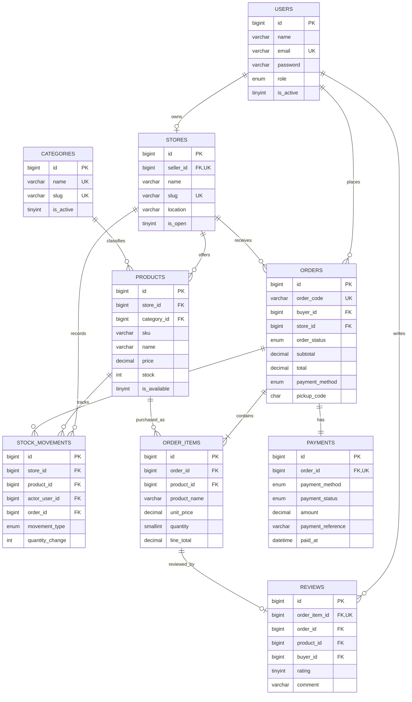

# UIBite — Entity Relationship Diagram

## Relationship notes

- `stores.seller_id` is `UNIQUE`, so one seller can own at most one tenant store.
- A store can list many products and receive many orders.
- Each order belongs to exactly one buyer and one store.
- An order can contain multiple `order_items`, but the application and database trigger ensure every item belongs to the same store as its order.
- Each order has one payment record.
- `order_items.product_name` and `unit_price` are snapshots, preserving order history if the seller later edits the product.
- `reviews.order_item_id` is unique, so one purchased item can receive at most one review.
- `stock_movements.quantity_change` uses negative numbers for stock outflow and positive numbers for stock inflow.
